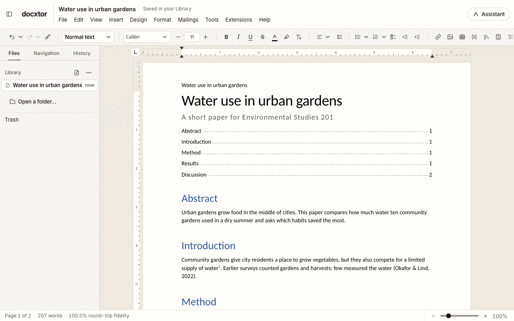

# Docxtor

Docxtor edits Word documents in the browser. You open a `.docx`, work on it on real pages, and save it back, and Word opens the result the way you left it. Anything Docxtor doesn't understand is written out again unchanged, and the parts of the file you didn't touch come out byte for byte.

It is free and open source (MIT or Apache-2.0), needs no account and no server, and keeps your files on your computer. The engine is written in Rust and runs as WebAssembly in the page.



Try it at https://docxtor.tinycommit.dev/. The documentation is at https://docxtor.tinycommit.dev/docs/.

## What you can do with it

Write and lay out documents the way you would in Word: styles, lists, tables, images, headers and footers, footnotes, a table of contents Word recognises, equations, page and section breaks. Pages break where they will on paper, and printing gives the pages you see.

Open Word, OpenDocument, Rich Text, web pages, Markdown, plain text and old `.doc` files. Save as Word, PDF, Markdown, text, OpenDocument, Rich Text, a web page or an EPUB book. Paste from Word, Google Docs and the web and the formatting comes along.

Ask an AI to edit the document. The assistant works with Anthropic, OpenAI, Gemini, OpenRouter, Groq, Mistral, Ollama, LM Studio or any OpenAI-compatible server, using your own key. It reads the document as text with an id on every paragraph and edits through tools such as `search`, `replace_text` and `insert_content`. You see each change as it happens and keep or undo it after reading a word-by-word comparison.

Give the same tools to other programs. A command-line tool and an MCP server let Claude Code, Cursor or your own scripts read and edit `.docx` files.

Add to it. Commands, toolbar buttons, panels, file formats, templates, themes, AI providers and storage are all extensions, on the API Docxtor's own features use. [The extensions guide](https://docxtor.tinycommit.dev/docs/extensions) explains how to write one.

What leaves your browser, and when, is listed in [PRIVACY.md](PRIVACY.md); a test holds the app to that list.

### What doesn't work yet

- Pages are laid out by the browser, not by Word's engine. Lines break the same way when the fonts match, but a page can break in a different place.
- Comments and tracked changes are kept in the file but not shown. A tracked deletion appears as a labelled placeholder. Showing and editing them is next on [the roadmap](https://docxtor.tinycommit.dev/docs/roadmap).
- Typing right after the result of a complex field (a hyperlink or date field, for example) adds the text to the field's result.

## Browsers

Chrome and Edge run everything, and all of the more than 2,300 browser tests run on Chrome for every change. Firefox and Safari run the core of editing (opening, typing, formatting, lists, tables, pasting, undo, find, saving and printing), which 46 tests check on Firefox and WebKit for every change. A few features need Chrome or Edge: saving a file in place on your computer, opening a folder, picking a colour from the screen, and using your installed fonts in a PDF. Docxtor says so when one is missing, and opening a file and downloading a copy work everywhere. [The browsers page](https://docxtor.tinycommit.dev/docs/browsers) has the details.

## Run it from source

You need Rust through [rustup](https://rustup.rs) (it installs the release named in `rust-toolchain.toml`), [`wasm-pack`](https://rustwasm.github.io/wasm-pack/) and Node 22.18 or later.

*Sketch, not run by a test: installs tools on your machine; the steps are run and timed in CONTRIBUTING.md.*
```bash
cargo install wasm-pack --locked --version 0.15.0
```

*Sketch, not run by a test: setup and a dev server that keeps running; run and timed in CONTRIBUTING.md.*
```bash
npm install && npm run wasm && npm run dev
```

Then open http://localhost:5173. [CONTRIBUTING.md](CONTRIBUTING.md) has each step with how long it takes, and how to run the tests.

### Host your own copy

Docxtor is a folder of static files, so any web server can host it. Each release has a `docxtor-web-<version>.tar.gz` with nginx and Caddy settings, and a Docker image: `docker run -p 8080:8080 ghcr.io/tinycommit-dev/docxtor-web:<version>`. Serve it over HTTPS, or the browser turns off offline use, version history and the clipboard buttons. [The hosting guide](https://docxtor.tinycommit.dev/docs/deploy) covers the rest.

### Put the editor in your own product

The editor is also a component (`<docxtor-editor src="/report.docx">`, or the `DocxtorEditor` API), and the engine runs on its own in browsers, Node and edge functions. The npm packages (`@docxtor/core`, `@docxtor/extensions`, `@docxtor/editor`) are not published yet; [the embedding guide](https://docxtor.tinycommit.dev/docs/embedding) shows how to use them from a checkout. To let your users use the AI without a key in the page, see [the AI guide](docs/ai/your-users.md#giving-your-users-the-ai-without-a-key-in-the-page).

### The command line

<!-- example: readme-cli -->
```bash
cargo build --release -p docxtor-cli
./target/release/docxtor read report.docx          # DocScript view (what AI sees)
./target/release/docxtor tool report.docx replace_text '{"find":"Q3","replace":"Q4","all":true}'
./target/release/docxtor new notes.docx --markdown notes.md
./target/release/docxtor markdown report.docx > report.md
./target/release/docxtor export report.docx --format epub -o report.epub   # also html, odt and rtf
./target/release/docxtor corpus ./my-docs --min 99   # fidelity gate
```

`docxtor help` lists every command.

### The MCP server

*Sketch, not run by a test: needs the claude program; the MCP server itself is run by scripts/docs-examples.test.mjs.*
```bash
cargo build --release -p docxtor-mcp
claude mcp add docxtor -- "$(pwd)/target/release/docxtor-mcp"
```

Then ask your agent to "open ~/Documents/proposal.docx and tighten the executive summary". The server saves each edit to the file; set `DOCXTOR_MCP_AUTOSAVE=0` to save only when the agent calls `save_document`. [The AI guide](https://docxtor.tinycommit.dev/docs/ai) has the full list of tools.

## How the file stays intact

Most editors turn a document into their own format when they open it and back into Word's when they save, and whatever doesn't fit is lost on the way. Docxtor edits the document's own XML. Parts you don't touch (headers, themes, images, settings) are written back as they were. In the main document, formatting stays as the original XML, edits change it in place, and elements Docxtor doesn't know stay where they were.

`docxtor corpus` measures this on a folder of files: whether each opens, whether saving it untouched loses anything, and how much survives when every paragraph is written out again. CI runs it on every change, with Microsoft's Open XML validator on the files Docxtor saves. Every night it also compares LibreOffice's printout of each original with its saved copy. [The fidelity page](https://docxtor.tinycommit.dev/docs/fidelity) explains the scores. A `.docx` that doesn't come back intact is the most useful bug report you can send.

[The architecture page](https://docxtor.tinycommit.dev/docs/architecture) describes how the code is organised.

## Contributing

See [CONTRIBUTING.md](CONTRIBUTING.md). For a document that doesn't save correctly, run `docxtor corpus` on it and attach the file to the issue (with anything private removed).

## License

Docxtor is dual-licensed under [MIT](LICENSE-MIT) or [Apache-2.0](LICENSE-APACHE), at your option, and contributions are accepted under the same terms. The spelling dictionaries keep their own licences; see [THIRD_PARTY_NOTICES.md](THIRD_PARTY_NOTICES.md).
