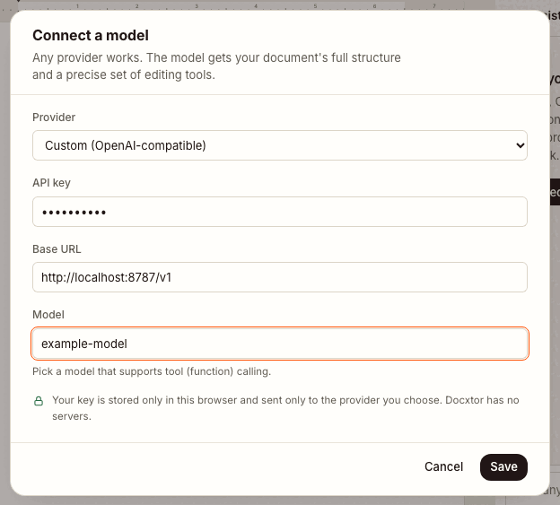
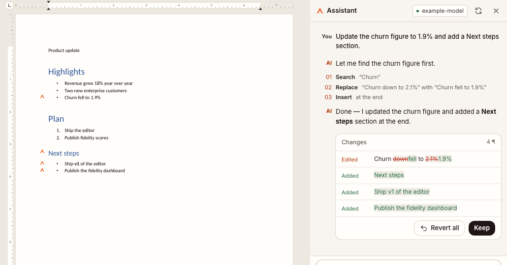

# Work with the assistant

The assistant is a chat panel that edits your document for you. You describe what you want, it reads the document and makes the edits, and you see every change before you decide to keep it. It uses your own AI account or a model on your own computer. Docxtor does not provide a model and has no AI server.

## Connect a model

1. Click **Assistant** at the top right, or press Ctrl+/ (⌘/).
2. Click **Connect a model**.
3. Choose a provider and give it what it needs.

| Provider | What you give it |
|---|---|
| Anthropic (Claude) | An API key, a model and an effort level (low to max). Higher effort thinks harder on complex edits and costs more. |
| OpenAI, OpenRouter, Google Gemini, Groq, Mistral | An API key and a model. Choose one that supports tool (function) calling. |
| Ollama or LM Studio | No key. They run on your computer. Allow browser requests first: start Ollama with `OLLAMA_ORIGINS=*`, or switch on LM Studio's CORS option. Choose a model that supports tools. |
| Custom (OpenAI-compatible) | A base URL, a key if it needs one, and a model. For any service or gateway that speaks the same protocol. |

You pay your provider for what you use, under your own account. Docxtor does not see or charge for it.

## Ask for an edit

Type in the box at the bottom and press Enter (Shift+Enter adds a line). For example "Make the abstract shorter", "Change every heading to sentence case", or "Add a Next steps section at the end".

The assistant works through the same operations you do: it searches, reads, replaces text, inserts paragraphs, formats text and so on. The panel lists each step as it goes, and the edits appear in the document at once. Stop ends a run part-way.

You can also select some text and use the small bar that appears over it. **Ask AI** in that bar offers quick actions on just the selection: Improve writing, Fix spelling and grammar, Make shorter, Make longer, Simplify, Make it a list, and Translate.

## Review what it changed

When a run is done the panel shows a **Changes** card that lists every paragraph that changed, with the words added in green and the words removed struck through. Changed paragraphs also get a mark in the margin of the page.

- **Keep** accepts the changes. They stay in the normal undo history, so Ctrl+Z still takes them back.
- **Revert all** puts the document back exactly as it was before the run.

You can also undo any single step with Ctrl+Z (⌘Z), and the History tab keeps a version from just before and just after the assistant's change.

The assistant cannot change a document that is open as read-only (View, Mode, Viewing); it says so.

## What is sent where

Your key is kept in this browser and sent only to the provider you chose. Docxtor has no server of its own in between.

When you send a message, the provider receives your message and the document: its name, its text, the part you selected, and what the assistant reads or changes while it works. With Ollama or LM Studio the same goes to a program on your own computer and does not leave it. Read your provider's terms to see what it keeps. If a document must not leave your computer, use a local model or leave the assistant closed; nothing is sent until you send a message.

[Privacy](../../PRIVACY.md) lists every address Docxtor can reach, including the providers.

## Tips

- Give it a clear, limited job. "Rewrite the introduction in a plainer style" works better than "improve this".
- Ask it to find things first when the document is long: "List every place I wrote about cost."
- Check the Changes card before you click Keep. The assistant can be wrong, and it is quick to undo.
- Developers can give the same tools to other programs through the command line and the MCP server; see [AI, the CLI and MCP](../ai/index.md).
