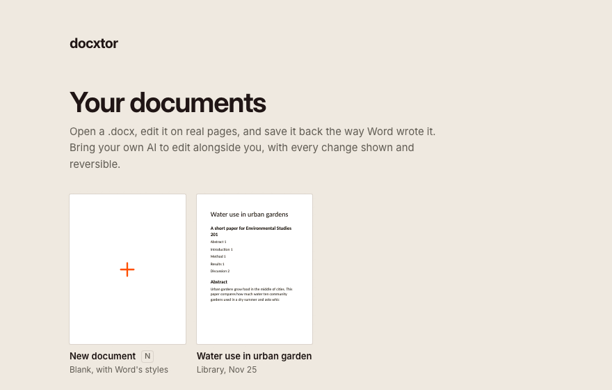

# Get started

This page covers opening Docxtor, getting a document on the page, and where your documents live. Nothing here needs an account.

## The start screen

Open [docxtor.tinycommit.dev](https://docxtor.tinycommit.dev/). You land on the start screen, with a tile for each thing you can do.

- **New document** (press N) opens a blank page with Word's styles.
- **Open a file** (O) picks a file from your computer.
- **Open a folder** (F) works on a whole folder of documents. It is there only in Chrome, Edge and other Chromium browsers.
- **Use a template** (U) starts from a letter, meeting notes, a report or a paper, or from a template of your own.
- **Take the tour** (T) opens a sample document that shows what Docxtor does.

Under the tiles you see the documents you worked on last. Each one has a bookmark button to pin it to the front. You can come back to the start screen at any time by clicking the docxtor name at the top left, or with File, Your documents.

## Open a document

Use File, Open (Ctrl+O, ⌘O), press O on the start screen, or drop a file onto the page.

Docxtor opens Word files (.docx), OpenDocument text (.odt), Rich Text (.rtf), web pages, old Word files (.doc), Word 2003 XML, Markdown and plain text. A .docx that Word would call damaged is repaired when it can be, and a notice tells you what changed. A password-protected file asks for its password.

Docxtor shows the file on pages, as Word does. What it does not show it still keeps: open a file and save it again and the parts you did not touch come out unchanged. The status bar at the bottom reports how much of the file came through unchanged, for example "100.0% round-trip fidelity".

## Start a new document

- **Blank:** File, New document (Ctrl+Alt+N, ⌥⌘N), or the New document tile. The text starts in the font you chose under Tools, Preferences.
- **From a template:** File, New from a template. Built in are Letter, Meeting notes, Report and Paper. Choose From a file to start from a Word template (.dotx) or any .docx on your computer.
- **Your own templates:** open a document you want to reuse and choose File, Save as template. It shows up under "Your templates" the next time. File, Download, Word template (.dotx) saves one as a file that Word opens too.

## Where your documents are kept

Documents you create, and files you open with a browser that cannot save to your disk, go into the **Library**. The Library is in the Files tab on the left, and it lives in this browser. Docxtor has no server, so nothing is uploaded when you open, edit or save.

Two things follow from that.

- **Clearing this site's data in the browser deletes the Library.** Use File, Download, Download all documents now and then; it gives you one .zip file with every document.
- **The Library belongs to one browser on one computer.** To use a document somewhere else, download a copy.

A few things do reach other sites when you use them, such as a font from Google Fonts, a dictionary lookup or the assistant. [Privacy](../../PRIVACY.md) lists each one, and what is sent.

### Files on your computer

In Chrome and Edge, Open a file and Open a folder work on the real files. Save writes the file back in place, and a document opened from a folder appears in the Files tab with the others. Autosave for them is off until you turn on Tools, Preferences, "Save files on your computer by themselves"; until then they save when you press Ctrl+S (⌘S).

In Firefox and Safari there is no way for a web page to write to a file you opened. Docxtor keeps a copy in your Library, and Save downloads the .docx.

### Folders, names, trash and recovery

- The Files tab has a New document button, a ⋯ menu, and Open a folder at the bottom.
- Rename, duplicate, pin or delete a document from its menu in the Files tab.
- A deleted document waits in the Trash for 30 days. Open Trash in the Files tab to restore it or delete it for good.
- If the page closes before changes were saved, Docxtor offers them back the next time as a recovered document (File, Recovered documents).
- Every document has its own address, such as `#/library/Reports/Q3.docx`. The back button and bookmarks work between documents.

## Work offline, install as an app

After your first visit Docxtor works without a connection. It keeps its own copy of the interface and its fonts. Things that need the internet, such as the assistant, a dictionary lookup or a DOI lookup, wait until you are back online.

To install it, use the install button in the address bar of Chrome or Edge, or the browser's menu. It then opens in its own window like any other app. Offline use and the install option need the page to be served over HTTPS, which the hosted site is.

## Appearance and language

- View, Theme chooses a light or dark interface.
- View, Display language switches the interface between English and Spanish. The language of the text you write is a separate setting, under File, Language; see [check your writing](proofing.md).
- View, Zoom, and the zoom slider at the bottom right, change how large the page is shown.
