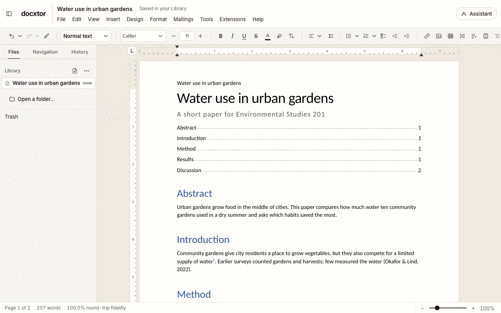

# Use Docxtor

Docxtor is a free editor for Word (.docx) files that runs in your browser. You open a real `.docx`, edit it on pages, and save it back. Whatever Docxtor does not understand is kept and written out unchanged, so the file still opens in Word. Your documents stay in your browser.

Open the app at [docxtor.tinycommit.dev](https://docxtor.tinycommit.dev/). There is nothing to install and no account to make.

## The guide

Each page is about one job. Read them in order the first time, or jump to the one you need.

- [Get started](getting-started.md): open a file, start a new document or a template, where your documents are kept, working offline.
- [Write and format](writing.md): text, styles, lists, fonts, spacing, page setup, headers, footers, page numbers, sections and columns.
- [Tables, pictures and shapes](tables-pictures-shapes.md): add them, change them and place them on the page.
- [Notes, citations and contents](notes-citations-contents.md): footnotes, citations and a reference list, a table of contents, captions and cross-references.
- [Check your writing](proofing.md): spelling, grammar, word count, find and replace, and languages.
- [Work with the assistant](assistant.md): connect a model, ask for an edit, and review what it changed.
- [Save, download and share](saving-sharing.md): where changes go, the formats you can download, version history and what Word sees.
- [Mail merge](mail-merge.md): letters, email, labels and envelopes from a list of people.
- [Shortcuts and the command palette](shortcuts.md): every keyboard shortcut, and how to find a command by name.
- [Limits](limits.md): what Docxtor does not do, and which browsers it works in.

## Keys in this guide

Shortcuts are written for Windows and Linux, with the Mac key after it: Ctrl+B (⌘B). Ctrl is ⌘ on a Mac, Alt is ⌥, and Shift is ⇧. Menu paths are written the way the app writes them in its own help: Insert, Page elements, Header means open the Insert menu, then Page elements, then Header.

## If you build with Docxtor

This guide is for people who write in it. To put the editor in your own page, see [embedding](../embedding.md); to run your own copy, see [putting Docxtor online](../deploy.md). [What leaves your browser](../../PRIVACY.md) is listed on the privacy page.
