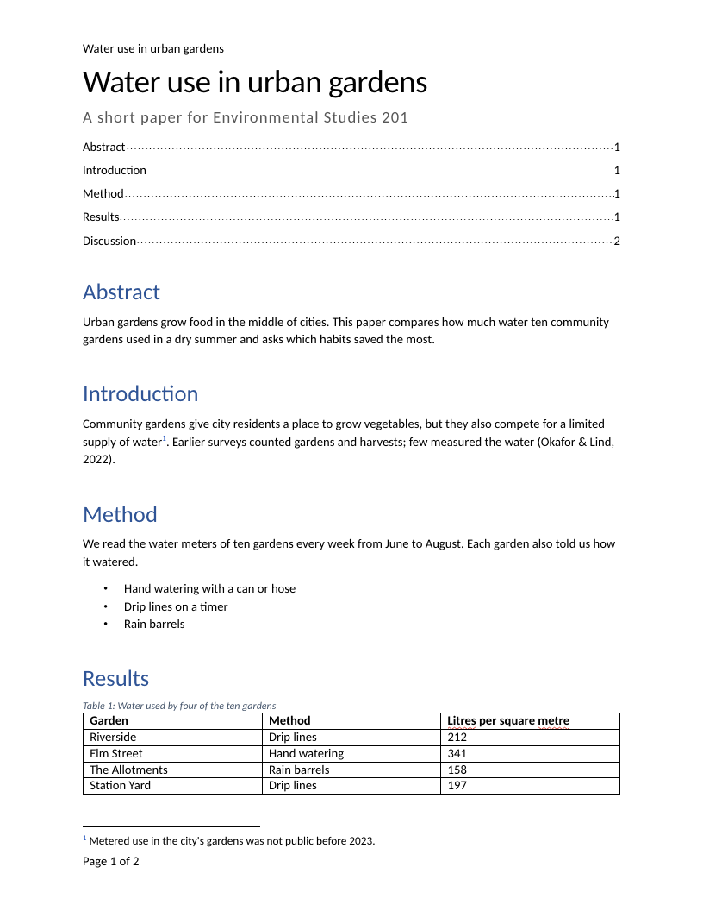
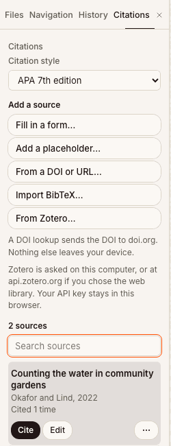

# Notes, citations and contents

The parts of a paper that Word calls references: footnotes and endnotes, citations with a reference list, a table of contents, captions and cross-references. Docxtor writes them as Word does, so Word keeps updating them.

## Footnotes and endnotes

Put the cursor after the word and choose Insert, Page elements, Footnote (Ctrl+Alt+F, ⌥⌘F), or Endnote (Ctrl+Alt+D, ⌥⌘D). The note is numbered for you and the cursor moves to it at the foot of the page, where you type. Docxtor leaves room for the note on the page that holds its mark.

- Double-click a note mark to edit its note. Insert, References, Go to a note jumps to the next or previous footnote (Ctrl+Alt+] and Ctrl+Alt+[, ⌥⌘] and ⌥⌘[).
- Insert, Page elements, Footnote and endnote options changes the number format and where numbering starts.
- Delete the mark in the text to delete the note. The rest renumber.

## Citations and a reference list

Insert, Citation opens the **Citations** tab on the left. Choose the style at the top, add sources, and cite them.

1. **Choose a style.** APA 7th edition, MLA 9th edition, Chicago 17th (author-date), IEEE and Harvard are built in. The list also has Chicago 16th and 18th (notes and bibliography), Vancouver, Nature and AMA 11th. "Add a style from a CSL file" adds any other CSL style. Change the style at any time and every citation and the list are written again. A notes style turns the citations into footnotes.
2. **Add a source.** There are five ways:
   - **Fill in a form** for a book, article, web page and other kinds.
   - **Add a placeholder** when you know you need a source but do not have it yet.
   - **From a DOI or URL** looks the DOI up at doi.org. Only the DOI is sent.
   - **Import BibTeX** reads entries pasted from Google Scholar, Zotero and similar tools. Export BibTeX at the bottom of the tab writes them out.
   - **From Zotero** reads your library, from Zotero on your computer or from your web library with an API key.
3. **Cite.** Put the cursor where the citation goes and click **Cite** on a source. Docxtor writes it in the style you chose, for example "(Okafor & Lind, 2022)".
4. **Add the reference list.** Insert, Bibliography puts the list where the cursor is, with the heading the style uses. It lists the sources you have cited, so cite first. The tab's Go to bibliography button jumps to it.

Sources are kept in the document, in the part of the file Word uses, so Word shows them under References, Manage Sources. The **Shared list** button keeps a list of sources in this browser, apart from any document, and copies sources between it and the document you are writing.

## Table of contents

Make the headings first, with the Heading styles. Then Insert, Page elements, Table of contents puts a table at the cursor with each heading and its page number. A few more things to know:

- Insert, Page elements, Table of contents options picks which heading levels to list, whether entries are links, the leader line and the look.
- The table does not change as you write. Choose Update table of contents to rebuild it, or Update page numbers only after the pages have moved. Update fields (F9) updates it with the other fields.
- Ctrl+click (⌘-click) an entry to go to its heading.
- To list text that is not a heading, select it and choose Insert, References, Add to table of contents and pick a level.
- Remove table of contents takes it out.

Docxtor updates tables of contents that Word made, too.

## Captions and cross-references

- **Caption.** Select a table or a picture and choose Insert, References, Caption. Pick a label (Figure, Table or Equation), type the text, and say whether it goes above or below. Numbers run in order for each label and renumber when you add one. "Include chapter number" gives "Figure 2-1" when the headings are numbered. AutoCaption sets which kinds of object get a caption automatically.
- **Cross-reference.** Insert, References, Cross-reference points to a heading, a numbered item, a bookmark, a footnote or endnote, or a caption. Choose what to show (the heading text, the number, the page, "Figure 1") and whether it is a link. The reference follows the text when you update fields.
- **Table of figures.** Insert, References, Table of figures lists the captions of one label with their pages.
- **Bookmarks.** Insert, Bookmark names a place so a cross-reference or link can point to it.

## Index

Select a word and choose Insert, References, Mark index entry. Insert, References, Index builds the index from the marks, and AutoMark marks every occurrence of the words on a list you give. Table of authorities, for legal documents, has its own marks under Insert, References.

## Also useful for writing papers

- Insert, Equation writes maths in LaTeX (see [tables, pictures and shapes](tables-pictures-shapes.md)).
- Tools, Dictionary and Tools, Thesaurus look a word up (see [check your writing](proofing.md)).
- File, New from a template, Paper starts with an abstract and references.
- Format, Paragraph styles, Quote is for block quotations.
