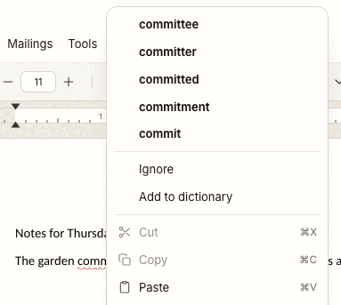
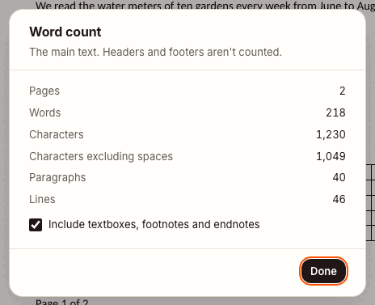
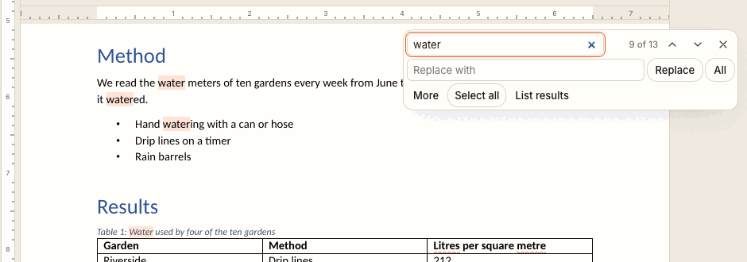

# Check your writing

Spelling, grammar, counting words, finding and replacing text, and telling Docxtor what language you are writing in.

## Spelling and grammar

Misspelled words get a wavy underline as you type. Right-click one to see corrections at the top of the menu, to ignore it, or to add it to your dictionary. Problems with grammar are marked the same way.

Tools, Spelling and grammar has the rest:

- **Spelling and grammar check** (Ctrl+Alt+X, ⌥⌘X) opens a panel that steps through each problem, with Change, Ignore and Add to dictionary.
- **Show spelling suggestions** and **Show grammar suggestions** turn the marks on and off. Hide spelling errors in this document, and the grammar version, do it for one document only.
- **Custom dictionaries** holds your own word lists. Docxtor keeps the words you add.
- **Readability statistics** shows counts and averages, and for English the Flesch Reading Ease and Flesch-Kincaid grade level.
- **Proofing options** has the choices: ignore words in capitals, words with numbers and web addresses; detect the language automatically; flag repeated words ("the the"); and flag frequently confused words such as "their" and "there".
- **Recheck document** checks everything again after you change an option.

Spelling uses word lists that come with Docxtor, for English (US and UK), Spanish, French and German, and checking sends nothing anywhere. Grammar rules for English, Spanish, French and German also run in the page. For other languages, or for a more thorough grammar check, you can turn on LanguageTool under Extensions, Manage extensions. LanguageTool is off until you do, it asks first, and **it sends the text of your document to its server**, which you can change to one you run yourself.

Tools, Dictionary (Ctrl+Shift+Y, ⇧⌘Y) looks up the selected word on Wiktionary; the word you look up is sent there. Tools, Thesaurus (Shift+F7) lists synonyms.

## Word count

The status bar shows the number of words and the page you are on. Tools, Word count (Ctrl+Shift+C, ⇧⌘C) opens the full count: pages, words, characters with and without spaces, paragraphs and lines. A tick box decides whether text boxes, footnotes and endnotes are included. Headers and footers are not counted.

## Find and replace

Press Ctrl+F (⌘F) to find. Matches are marked in the text and the bar shows "5 of 12". Enter goes to the next match and Shift+Enter to the one before; F3 and Ctrl+Shift+G also do it. Type in the Replace with box, then use Replace for one match or All for every match. Ctrl+Shift+H opens the same bar.

**More** opens the options:

- Match case, Whole words only, Match prefix, Match suffix.
- Use wildcards, or Regular expression, for patterns.
- Ignore punctuation, Ignore white space, Ignore accents, and Sounds like (English).
- **Search:** All, Down or Up from the cursor. **In:** all of the document, headers, footers and notes, or the main text only.
- **Special** inserts a code for a paragraph mark, tab, page break and others into the search or the replacement. **Format** finds or applies a font, paragraph setting, style, highlight or language.
- **Select all** selects every match so you can format them together, and **List results** shows them in a list.

Replacing keeps the formatting of the text it replaces. Edit, Go to (Ctrl+G, ⌘G) jumps to a page, a line, or an item such as a heading, bookmark or footnote.

## Languages

There are two languages to think about.

**The language of your text** decides which dictionary checks it, how quotes curl and how hyphenation works. File, Language sets it for the text you type next, or for the selected text only. "Do not check spelling or grammar" leaves a stretch alone, which is useful for code, names and quotations. A paragraph the file gives no language is checked in the language its words are in when Detect language automatically is on in Proofing options.

**The language of the interface** is View, Display language: English or Spanish.
