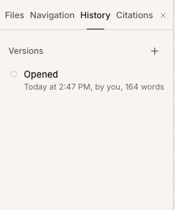

# Save, download and share

Docxtor has no cloud and no share link. A document is a file, and you share it the way you share any file. This page covers where your changes go, how to get a copy out, how to go back to an earlier version, and what to expect when the file opens in Word.

## Saving

Next to the document name at the top, Docxtor says "Saved in your Library", or "Unsaved changes" for a moment while it catches up.

- **Documents in your Library** save by themselves a moment after you stop typing (one second by default). Tools, Preferences, Saving changes how long it waits.
- **Files on your computer** (opened with Open a file or Open a folder in Chrome or Edge) save when you press Ctrl+S (⌘S). To save them by themselves too, turn on "Save files on your computer by themselves" in Tools, Preferences.
- **In Firefox and Safari** the document lives in your Library and Save downloads a .docx.
- File, Save as, Make a copy and Rename name or copy a document. File, Pin to the start screen keeps it at the front of your recent documents.

If the page closes before changes were saved, Docxtor offers them back the next time (File, Recovered documents).

## Download a copy

File, Download makes a file in the format you choose.

| Choice | What you get |
|---|---|
| Word document (.docx) | The document as Word saves it. |
| Markdown (.md) | Headings, lists, tables and text, without page layout. |
| Plain text (.txt) | The text only. |
| PDF document (.pdf) | The pages as they look on screen. The PDF can be tagged so screen readers can use it. |
| PDF/A archive (.pdf) | A PDF for long-term storage. |
| OpenDocument text (.odt) | For LibreOffice and similar programs. |
| Rich Text (.rtf) | An older format most programs read. |
| Web page (.html) | A page for a browser. |
| EPUB book (.epub) | For e-readers. |
| Word template (.dotx) | A template Word offers under New. |
| Download all documents | Every document in your Library, in one .zip file. |

File, Print (Ctrl+P, ⌘P) prints the pages as they look on screen, and Print selection prints only what you selected.

## Version history

Docxtor keeps versions of each document in this browser. Open the **History** tab on the left (or File, Version history, Ctrl+Alt+Shift+H, ⌥⇧⌘H).

- A version is recorded when you save, every few minutes while you edit (five by default; Tools, Preferences changes it), and just before and after every change the assistant makes.
- **Compare.** Click a version to see what changed, as words added, removed or edited, against the document now or against the version before it.
- **Restore** brings a version back. The version you leave is kept first, so restoring can be undone.
- **Name** a version, or use the plus button at the top to save one yourself, to find it later. **Download this version** saves it as a file.

Formatting-only changes are not listed in the comparison yet.

## Share a document

- Download a .docx and send it, or put it in a shared folder.
- Open a folder (Chrome and Edge) works on the files in a folder on your computer, so a folder that a sync service keeps in step gives you the same documents on each computer. Two people editing the same file at the same time is not supported.
- To protect a document, File, Protect with password asks for a password that anyone who opens it will need. Docxtor cannot recover a lost password.
- File, Mark as final tells readers the document is finished, and Tools, Restrict editing limits what can be changed.
- Before you send a file, Tools, Inspect document lists what it carries besides the page, such as author names and personal properties, and can remove them. File, Document details has the title, author, keywords and other properties.

## What opens in Word

Docxtor works on your .docx, not on a copy. Anything it does not understand is kept as it was, and parts of the file you did not touch come out byte for byte the same. The status bar shows the share of the file that came through unchanged, for example "100.0% round-trip fidelity". Word's own checks and a second reader, LibreOffice, are run over Docxtor's files on every release; [Fidelity](../fidelity.md) has the method and the numbers.

What Word shows the same: text and formatting, styles, lists, tables, pictures and shapes, headers and footers, footnotes, fields, tables of contents, citations, charts, equations, sections and page setup.

What can differ:

- **Page breaks.** Docxtor lays pages out with your browser, not with Word's engine. Lines break at the same places when the fonts match, but a page can end a line earlier or later. Use the fonts the document asks for.
- **Missing fonts.** If a font is not on your computer Docxtor shows a look-alike. Word will show the real font if the reader has it.
- **Comments and tracked changes** are kept in the file but not shown; see [limits](limits.md).
