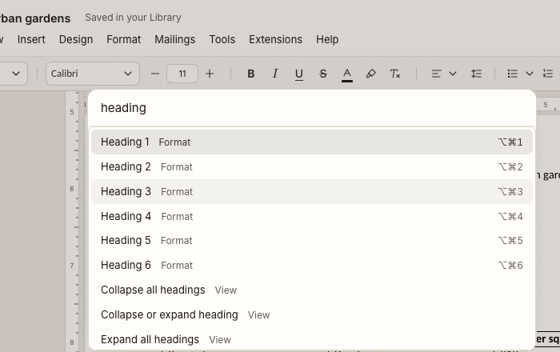

# Shortcuts and the command palette

## Find a command by name

Press Ctrl+Shift+P (⇧⌘P), or Alt+/ (⌥/), or choose Help, Search the menus. A box opens where you type part of a command's name. The list narrows as you type, shows each command's shortcut, and Enter runs the one you chose. Everything in the menus is there, and so are commands that have no button.

## Change a shortcut

Tools, Customize keyboard shortcuts (or Tools, Preferences, Change shortcuts) lists every command. Give one a key of your own, or take its key away. If the key already belongs to another command, it moves to the one you are changing. Reset brings the original back.

## Keys the table does not list

- **Tab and Shift+Tab** move to the next or previous cell in a table, and change the level of a list item. Enter on an empty list item ends the list.
- **Esc** closes a box, leaves a header or footer, or leaves Focus view.
- **The arrow keys, Home and End** move around; add Shift to select.

## All shortcuts

The table is made from the commands the app registers. If you have changed a shortcut, your own key is the one that works; the table shows the keys that come with Docxtor.

<!-- shortcuts:start -->

### Arrange

| Command | Windows and Linux | Mac |
|---|---|---|
| Selection pane | `Alt+F10` | `⌥F10` |

### Edit

| Command | Windows and Linux | Mac |
|---|---|---|
| Copy | `Ctrl+C` | `⌘C` |
| Cut | `Ctrl+X` | `⌘X` |
| Find and replace | `Ctrl+F` or `Ctrl+Shift+H` | `⌘F` or `⇧⌘H` |
| Find next | `F3` | `F3` |
| Find previous | `Ctrl+Shift+G` | `⇧⌘G` |
| Go to end of document | `Ctrl+End` | `⌘↓` or `⌘End` |
| Go to start of document | `Ctrl+Home` | `⌘↑` or `⌘Home` |
| Go to… | `Ctrl+G` or `F5` | `⌘G` or `F5` |
| Paste | `Ctrl+V` | `⌘V` |
| Paste as plain text | `Ctrl+Shift+V` | `⇧⌘V` |
| Redo | `Ctrl+Shift+Z` or `Ctrl+Y` | `⇧⌘Z` or `⌘Y` |
| Select all | `Ctrl+A` | `⌘A` |
| Select all matching text | `Ctrl+Alt+A` | `⌥⌘A` |
| Select to end of document | `Ctrl+Shift+End` | `⇧⌘↓` or `⇧⌘End` |
| Select to start of document | `Ctrl+Shift+Home` | `⇧⌘↑` or `⇧⌘Home` |
| Undo | `Ctrl+Z` | `⌘Z` |
| Update fields | `F9` | `F9` |

### File

| Command | Windows and Linux | Mac |
|---|---|---|
| New document | `Ctrl+Alt+N` | `⌥⌘N` |
| Open… | `Ctrl+O` | `⌘O` |
| Print… | `Ctrl+P` | `⌘P` |
| Save | `Ctrl+S` | `⌘S` |
| Save as… | `Ctrl+Shift+S` | `⇧⌘S` |
| Version history | `Ctrl+Alt+Shift+H` | `⌥⇧⌘H` |

### Format

| Command | Windows and Linux | Mac |
|---|---|---|
| Align left | `Ctrl+Shift+L` | `⇧⌘L` |
| Align right | `Ctrl+Shift+R` | `⇧⌘R` |
| Bold | `Ctrl+B` | `⌘B` |
| Bulleted list | `Ctrl+Shift+8` | `⇧⌘8` |
| Center | `Ctrl+Shift+E` | `⇧⌘E` |
| Change case | `Shift+F3` | `⇧F3` |
| Checklist | `Ctrl+Shift+9` | `⇧⌘9` |
| Clear formatting | `Ctrl+\` | `⌘\` |
| Copy formatting | `Ctrl+Alt+C` | `⌥⌘C` |
| Decrease font size | `Ctrl+Shift+,` | `⇧⌘,` |
| Decrease indent | `Ctrl+[` | `⌘[` |
| Done | `Ctrl+Alt+Enter` | `⌥⌘↩` |
| Font… | `Ctrl+D` | `⌘D` |
| Heading 1 | `Ctrl+Alt+1` | `⌥⌘1` |
| Heading 2 | `Ctrl+Alt+2` | `⌥⌘2` |
| Heading 3 | `Ctrl+Alt+3` | `⌥⌘3` |
| Heading 4 | `Ctrl+Alt+4` | `⌥⌘4` |
| Heading 5 | `Ctrl+Alt+5` | `⌥⌘5` |
| Heading 6 | `Ctrl+Alt+6` | `⌥⌘6` |
| Increase font size | `Ctrl+Shift+.` | `⇧⌘.` |
| Increase indent | `Ctrl+]` | `⌘]` |
| Italic | `Ctrl+I` | `⌘I` |
| Justify | `Ctrl+Shift+J` | `⇧⌘J` |
| Normal text | `Ctrl+Alt+0` | `⌥⌘0` |
| Numbered list | `Ctrl+Shift+7` | `⇧⌘7` |
| Paste formatting | `Ctrl+Alt+V` | `⌥⌘V` |
| Reveal formatting | `Shift+F1` | `⇧F1` |
| Small caps | `Alt+Shift+K` | `⌥⇧K` |
| Strikethrough | `Ctrl+Shift+X` | `⇧⌘X` |
| Styles panel | `Ctrl+Alt+Shift+S` | `⌥⇧⌘S` |
| Subscript | `Ctrl+,` | `⌘,` |
| Superscript | `Ctrl+.` | `⌘.` |
| Underline | `Ctrl+U` | `⌘U` |

### General

| Command | Windows and Linux | Mac |
|---|---|---|
| Show all commands | `Ctrl+Shift+P` or `Alt+/` | `⇧⌘P` or `⌥/` |

### Help

| Command | Windows and Linux | Mac |
|---|---|---|
| Help | `F1` | `F1` |

### Image

| Command | Windows and Linux | Mac |
|---|---|---|
| Alt text… | `Ctrl+Alt+Y` | `⌥⌘Y` |

### Insert

| Command | Windows and Linux | Mac |
|---|---|---|
| Add to table of contents… | `Ctrl+Alt+Shift+O` | `⌥⇧⌘O` |
| Endnote | `Ctrl+Alt+D` | `⌥⌘D` |
| Equation… | `Alt+=` | `⌥=` |
| Expand AutoText | `Ctrl+Alt+F3` | `⌥⌘F3` |
| Footnote | `Ctrl+Alt+F` | `⌥⌘F` |
| Link | `Ctrl+K` | `⌘K` |
| Mark index entry… | `Ctrl+Alt+Shift+X` | `⌥⇧⌘X` |
| Non-breaking hyphen | `Ctrl+Shift+-` | `⇧⌘-` |
| Optional hyphen | `Ctrl+-` | `⌘-` |
| Page break | `Ctrl+Enter` | `⌘↩` |
| Save selection to Quick parts… | `Alt+F3` | `⌥F3` |

### Mailings

| Command | Windows and Linux | Mac |
|---|---|---|
| Edit recipient list… | `Alt+Shift+E` | `⌥⇧E` |
| Finish and merge… | `Alt+Shift+N` | `⌥⇧N` |
| Insert merge field… | `Alt+Shift+F` | `⌥⇧F` |

### Outline

| Command | Windows and Linux | Mac |
|---|---|---|
| Collapse | `Alt+Shift+-` | `⌥⇧-` |
| Demote | `Alt+Shift+→` | `⌥⇧→` |
| Expand | `Alt+Shift+=` | `⌥⇧=` |
| Move down | `Alt+Shift+↓` | `⌥⇧↓` |
| Move up | `Alt+Shift+↑` | `⌥⇧↑` |
| Promote | `Alt+Shift+←` | `⌥⇧←` |
| Show all levels | `Alt+Shift+A` | `⌥⇧A` |
| Show first line only | `Alt+Shift+L` | `⌥⇧L` |
| Show level 1 | `Alt+Shift+1` | `⌥⇧1` |
| Show level 2 | `Alt+Shift+2` | `⌥⇧2` |
| Show level 3 | `Alt+Shift+3` | `⌥⇧3` |
| Show level 4 | `Alt+Shift+4` | `⌥⇧4` |
| Show level 5 | `Alt+Shift+5` | `⌥⇧5` |
| Show level 6 | `Alt+Shift+6` | `⌥⇧6` |
| Show level 7 | `Alt+Shift+7` | `⌥⇧7` |
| Show level 8 | `Alt+Shift+8` | `⌥⇧8` |
| Show level 9 | `Alt+Shift+9` | `⌥⇧9` |

### References

| Command | Windows and Linux | Mac |
|---|---|---|
| Mark citation… | `Alt+Shift+I` | `⌥⇧I` |
| Next footnote | `Ctrl+Alt+]` | `⌥⌘]` |
| Previous footnote | `Ctrl+Alt+[` | `⌥⌘[` |

### Tools

| Command | Windows and Linux | Mac |
|---|---|---|
| Dictionary | `Ctrl+Shift+Y` | `⇧⌘Y` |
| Screen reader support | `Ctrl+Alt+Z` | `⌥⌘Z` |
| Spelling and grammar check | `Ctrl+Alt+X` | `⌥⌘X` |
| Thesaurus | `Shift+F7` | `⇧F7` |
| Word count | `Ctrl+Shift+C` | `⇧⌘C` |

### View

| Command | Windows and Linux | Mac |
|---|---|---|
| Assistant | `Ctrl+/` | `⌘/` |
| Compact mode | `Ctrl+Shift+F` | `⌃⇧F` |
| Field codes | `Alt+F9` | `⌥F9` |
| Next tab | `Ctrl+Alt+Pagedown` | `⌥⌘Pagedown` |
| Outline | `Ctrl+Alt+O` | `⌥⌘O` |
| Previous tab | `Ctrl+Alt+Pageup` | `⌥⌘Pageup` |
| Show non-printing characters | `Ctrl+Alt+P` | `⌥⌘P` |
| Show or hide this field's code | `Shift+F9` | `⇧F9` |
| Split | `Ctrl+Alt+S` | `⌥⌘S` |
| Zoom in | `Ctrl+Alt+=` | `⌥⌘=` |
| Zoom out | `Ctrl+Alt+-` | `⌥⌘-` |

<!-- shortcuts:end -->
