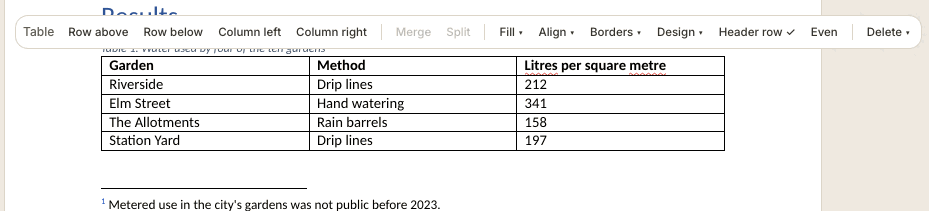

# Tables, pictures and shapes

Tables, pictures, text boxes, shapes, charts and equations are all real Word objects. Word shows and edits them the same way after you save.

## Tables

### Add a table

- Click the table button in the toolbar and drag across the grid to choose the columns and rows.
- Insert, Table puts a default table at the cursor.
- Format, Table, Insert table asks for the number of columns and rows, and whether the columns have a fixed width or fit their contents.
- Format, Table, Convert text to table turns the selected paragraphs into a table; you choose the character that separates the cells. Convert table to text goes the other way.

### Change a table

When the cursor is in a table, a small bar of table tools appears next to it: Row above, Row below, Column left, Column right, Merge, Split, Fill, Align, Borders, Design, Header row, Even (equal column widths) and Delete.

The same actions, and more, are in Format, Table:

- **Select cells** by dragging across them, then Merge cells or Unmerge cells. Split cells divides one cell into any number of columns and rows; Split table breaks a table in two at the cursor.
- **Drag the line between two columns** to resize them. Distribute rows and Distribute columns even them out.
- **Repeat header row on each page** keeps the first row at the top of every page a long table runs over.
- **Table design** offers Word's built-in looks: Table Grid, Plain, Grid and List tables in several colours. Header row, Total row, Banded rows, First column, Last column and Banded columns switch the parts of a design on and off.
- **Borders and shading** sets lines and fills for the selected cells or the whole table.
- **Table properties** has the width, alignment and text wrapping of the table, the height of rows (and whether a row may break across pages), cell margins and vertical alignment, and alt text for the table.
- **Sort table** orders the rows by one or more columns. **Formula** puts a calculation in a cell, using numbers, functions, and ABOVE, LEFT, RIGHT, BELOW or cell names such as A1.
- **Text direction** turns the text in a cell across, down or up.

## Pictures

### Add a picture

- Insert, Image, From your computer, or the picture button in the toolbar.
- Insert, Image, From a URL fetches a picture from a web address.
- Drop a picture file onto the page, or paste one you copied.

Select a picture to resize it by its corners. A picture is in line with the text at first, like a large character. To place it freely on the page, choose Format, Image, Position and layout, which has the wrapping choices (in line with text, square, tight, through, top and bottom, behind or in front of text) and where on the page it sits.

### Change a picture

Format, Image has:

- **Crop**, and **Crop to shape** or **Crop to aspect ratio** for a circle, a rounded corner, a square, 16:9 and others.
- **Rotate and flip**, and **Reset picture** to undo all of its changes.
- **Format picture** for brightness and contrast, recolouring, an outline, and effects such as shadow, glow, soft edges and reflection.
- **Alt text** (Ctrl+Alt+Y, ⌥⌘Y): a sentence describing the picture for people who cannot see it. Screen readers read it. Write it for pictures that carry meaning; the accessibility check lists the ones that have none.
- **Replace image** swaps the file and keeps the size and place.

## Text boxes, shapes and drawings

Insert, Drawing has three choices.

- **Text box** adds a box you can type in and place anywhere on the page.
- **Shape** opens a gallery of Word's shapes: lines and arrows, rectangles, basic shapes, block arrows, callouts and more. Click one, then drag on the page.
- **Draw** lets you sketch with a pen, with a choice of colour and width, an eraser, and a lasso that selects strokes to move, recolour or delete.

Select a shape and use Format, Shape: Format shape, Edit text, Fill, Outline, Edit points (to reshape it), the wrapping choices, Alt text and Delete shape.

Format, Arrange puts objects in order and in groups:

- Bring to front, Bring forward, Send backward and Send to back.
- Group and Ungroup, to move several shapes as one.
- Rotate, Flip, and Align (to each other, the margin or the page).
- **Selection pane** (Alt+F10, ⌥F10) lists every object on the page so you can select, hide or reorder one that is hard to click.

Docxtor draws SmartArt and WordArt from the file but does not edit them.

## Charts

Insert, Chart makes a Word chart: Column, Bar, Line and Pie, with More types for doughnut, area, scatter, radar, bubble, stock, surface and combination charts. Select a chart and use Format, Chart, Edit chart to change its data, colours, axes and labels. The numbers are kept inside the file in a workbook, as Word keeps them, so Word can edit the chart too.

## Equations

Insert, Equation (Alt+=) opens a box where you type LaTeX and see the result as you go. A palette has fractions, roots, sums, integrals, matrices, Greek letters and operators. The equation is saved as Word's own math markup, so Word can edit it. Double-click an equation to edit it again.

## More things to insert

The Insert menu also has Horizontal line, Special characters, Emoji, Date and time, Drop cap, Optional hyphen and Non-breaking hyphen, Form controls (check box, drop-down list, date picker and more), Smart chips (a person, a date, a status), and Building blocks such as meeting notes. Quick parts saves a piece of text you use often under a name, so you can insert it again (Alt+F3 saves the selection, ⌥F3 on a Mac).
