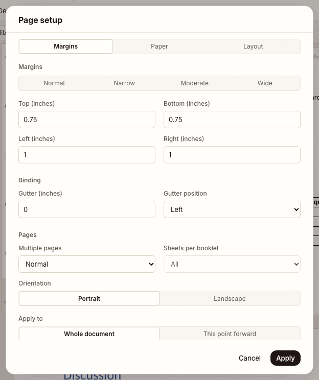
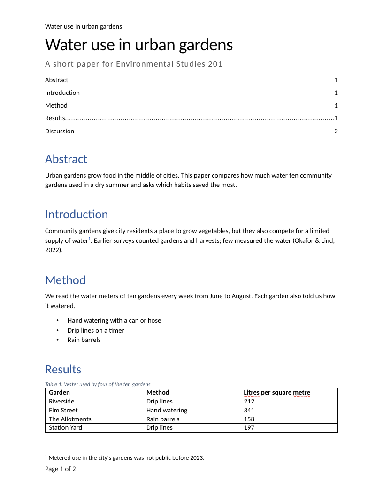

# Write and format

Most of what you do in a document is here: type, style the text, make lists, set the page up, and add headers, footers and page numbers. Everything below is saved the way Word saves it, so Word shows it the same way.

## Text and fonts

Select text and use the toolbar, the Format, Text menu or the shortcuts: Bold (Ctrl+B, ⌘B), Italic (Ctrl+I, ⌘I), Underline (Ctrl+U, ⌘U) and Strikethrough (Ctrl+Shift+X, ⇧⌘X). Superscript and Subscript are under Format, Text too, and so are Small caps, All caps and Change case.

Format, Font opens the full font box (Ctrl+D, ⌘D): the family, size, colour, highlight, underline styles and effects. The toolbar has the family and size boxes, the text colour and the highlight.

A document can use fonts your computer does not have. Docxtor shows a look-alike and warns you, and Format, Replace missing fonts swaps the missing font for one you have. The font in the file stays as it was unless you replace it.

Format painter (the paintbrush at the left of the toolbar) copies the look of one piece of text onto another. Clear formatting (Ctrl+\, ⌘\) takes the look off the selected text.

## Styles and headings

A style is a saved look for a kind of paragraph. The box at the left of the toolbar shows the style of the paragraph you are in; choose another one there, or use Format, Paragraph styles.

- **Normal text, Title, Subtitle, Heading 1 to Heading 6 and Quote** are the styles you will use most. Heading 1 to 6 have shortcuts: Ctrl+Alt+1 to 6 (⌥⌘1 to 6), and Ctrl+Alt+0 (⌥⌘0) for Normal text.
- **Headings drive the rest.** The Navigation tab on the left lists the headings as an outline you can click, and the table of contents is built from them.
- **To change a style**, put the cursor in a paragraph that uses it, change how it looks, then choose Format, Paragraph styles, Update style to match the selection. Modify style, Create a style from the selection and New style are in the same menu. The Styles panel (Ctrl+Alt+Shift+S, ⌥⇧⌘S) lists every style, and Reveal formatting (Shift+F1) shows what a piece of text is made of.

Design, Themes, Colors and Fonts change the colours and fonts of the whole document at once, because styles refer to the theme. Design, Style set swaps the look of all the styles, and Design, Paragraph spacing picks how tight or loose paragraphs sit. Set as default keeps your choice for new documents.

## Paragraphs and spacing

Format, Align and indent has left, centre, right, justify and distributed alignment, indents, and left-to-right and right-to-left text. Format, Line and paragraph spacing has single, 1.15, 1.5 and double, space before and after, and the "keep with next", "keep lines together" and "page break before" switches. Format, Paragraph and Format, Tabs open the full boxes. Borders and shading is under Format too.

## Lists

Format, Bullets and numbering has bulleted lists (Ctrl+Shift+8, ⇧⌘8), numbered lists (Ctrl+Shift+7, ⇧⌘7) and checklists (Ctrl+Shift+9, ⇧⌘9), with a choice of bullet and numbering styles. Tab and Shift+Tab move an item down or up a level; Enter on an empty item ends the list. The same menu has Restart numbering, Continue previous numbering and Set numbering value. Define new bullet, number format or multilevel list make your own.

## Typing shortcuts

While you type, Docxtor can turn "straight" quotes into curly ones, capitalise the first word of a sentence, make a web address into a link, and use Markdown habits: type `# ` and a space for a heading, `- ` for a bulleted list, or `---` and Enter for a line. These are on by default. Turn any of them off under Tools, Preferences, which also lists the text substitutions (such as turning `(c)` into ©) and lets you add your own.

## Page setup

File, Page setup has three tabs.

- **Margins:** the four margins, a gutter for binding, mirror margins for two-sided printing, several pages per sheet or a booklet fold, and the orientation.
- **Paper:** the paper size, or a custom width and height.
- **Layout:** where a new section starts, different first page, different odd and even pages, how far the header and footer sit from the edge, vertical alignment of the text, and line numbers.

Choose "Whole document" or "This point forward" to say which part of the document the change applies to. Format, Page orientation, Page borders and Page color are shortcuts to parts of the same job.

## Headers, footers and page numbers

Insert, Page elements, Header (or Footer) shows a small gallery: Blank, Blank with three columns, Title, Title and date, Banded, and Title and page number. Pick one and type into it. You can also double-click the top or bottom margin of a page to edit its header or footer. While you are in one, a strip above the page has buttons for the page number, the number of pages and the date, Different first page, Different odd and even, and Link to previous. Done, or Esc, takes you back to the text.

- **Page numbers.** Insert, Page numbers puts a number at the top or bottom of the page, or in the margin, as a plain number or "Page X of Y", at the left, centre or right. Page number options sets the format (1, i, a and so on) and where counting restarts. Remove page numbers takes them out.
- **Different first page** and **different odd and even pages** are on that strip and in File, Page setup, Layout.
- **Link to previous** makes a section show the header or footer of the section before it, or gives it its own. It is on the strip and in Insert, Page elements.
- **Fields.** Page numbers, the number of pages and the date are fields, and Insert, Field adds others. Update fields (F9) refreshes them.

## Breaks, sections and columns

Insert, Break adds a page break (Ctrl+Enter, ⌘↩), a column break, or a section break that starts on the next page, continues on the same page, or starts on an even or odd page. A section can have its own margins, orientation, columns, headers and footers.

Format, Columns sets one, two or three columns for the text (or "left" and "right" for a narrow column beside a wide one). "More options" sets the width, the space between and a line between the columns. Columns show on screen in Chrome and Edge. In other browsers a section with columns shows as one column on screen; the settings are kept in the file and Word shows the columns. See [limits](limits.md).

## Look at the document differently

View, Mode switches between Editing and Viewing (read-only). View, Layout changes how the pages are drawn: Print layout, Pageless (no page breaks), Reading, Outline and Draft. View, Zoom has fit-to-width, whole page and several pages across. View, Immersive has Focus and Line focus for writing without distraction. The ruler, non-printing characters (Ctrl+Alt+P, ⌥⌘P), gridlines and field codes can be shown from the View menu.
